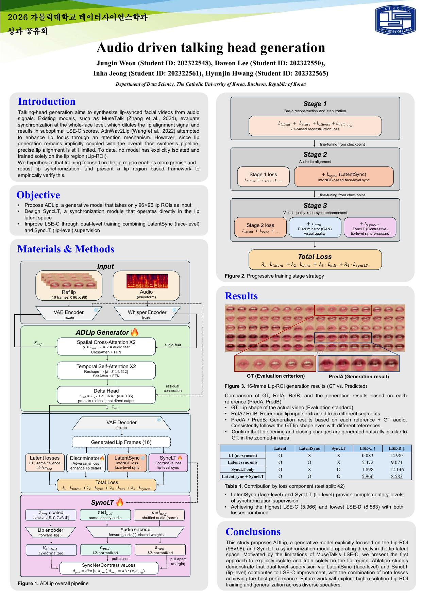
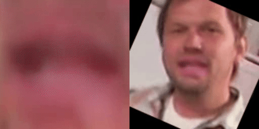
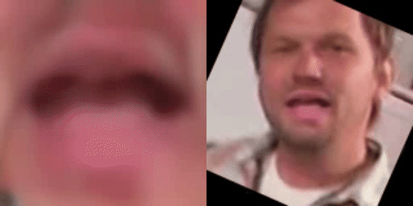
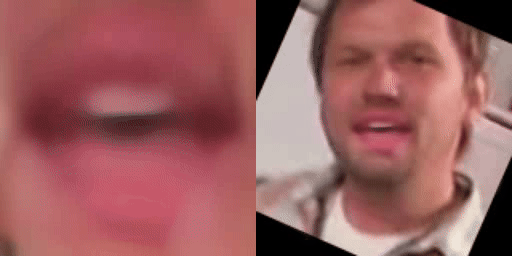

# 👄 ADLip2

> Audio-driven lip-sync generation that edits only the 96×96 lip region in VAE latent space, trained with a lip-level sync loss (SyncLT), plus an English → Korean dubbing pipeline on top.

<br>

## Overview

Lip-sync models such as MuseTalk learn synchronization over the whole lower face, so the lip alignment signal gets diluted and LSE-C stays low. ADLip2 tests whether training on the lip region alone, with a sync loss learned directly in lip latent space (SyncLT), gives more precise synchronization. Combining the face-level LatentSync loss with SyncLT gives the best LSE-C (5.966) and LSE-D (8.583) in the team's ablation, and the trained model also dubs a face into Korean speech produced by an STT → translation → TTS pipeline.

<br>

## Approach

- **Data**: HDTF talking-head videos, preprocessed into one folder per video; split lists in `data/splits/` (train 318, val 39, test 45)
- **Preprocessing**: MediaPipe Face Mesh aligns each frame to a 256×256 face and crops a 96×96 lip box; audio becomes 16 kHz wav, Whisper-tiny features (one per 25 fps frame), and a LatentSync mel-spectrogram (80 frames/s)
- **Model**: A frozen SD VAE (`stabilityai/sd-vae-ft-mse`) encodes 16 reference lip frames; the generator (2 spatial cross-attention + 2 temporal self-attention layers) predicts a delta, `z_out = z_ref + α·delta` (α = 0.35), which the frozen VAE decodes
- **Losses**: Latent reconstruction terms, LatentSync loss (face level, frozen), SyncLT loss (lip level, frozen), and an optional mouth discriminator (GAN)
- **Training Stages**: Stage 1 reconstruction → Stage 2 adds LatentSync → Stage 3 adds GAN and SyncLT, each switched on by the loss weights in `configs/`
- **Dubbing**: Wav2Vec2 STT → mBART-50 English-to-Korean translation → FastSpeech2 + VocGAN (KSS voice), cut into phrases at pauses
- **Evaluation**: Latent L1 on the val split (`valid.py`); LSE-C / LSE-D on generated videos with syncnet_python (`eval_lse.py`)

```text
Ref Lip (16 × 96×96)                 Audio features
        │                                  │
  VAE Encoder (frozen)                     │
        └────────────► Generator ◄─────────┘
                Spatial Cross-Attention ×2
                Temporal Self-Attention ×2
                Delta Head
                       │
               VAE Decoder (frozen)
                       │
            Generated Lip Frames (16)
```



<br>

## Results

Loss ablation on 42 HDTF test videos, as reported by the team on the poster (`data/output/poster.jpg`, Table 1):

| Condition | LatentSync | SyncLT | LSE-C ↑ | LSE-D ↓ |
|---|---|---|---|---|
| L1 (no SyncNet) | ✗ | ✗ | 0.083 | 14.983 |
| LatentSync only | ✓ | ✗ | 5.472 | 9.071 |
| SyncLT only | ✗ | ✓ | 1.898 | 12.146 |
| **LatentSync + SyncLT** | ✓ | ✓ | **5.966** | **8.583** |

- LatentSync (face level) and SyncLT (lip level) give complementary signals; together they give the best LSE-C and LSE-D
- Lip information alone (SyncLT only) is not enough to learn synchronization
- `expD3` (`lambda_our=0.15`, `our_lambda_neg=2.5`) gives the most balanced SyncLT / LatentSync gradient ratio
- `expF1` (GAN + SyncLT) scores lower on LSE but looks most natural, so LSE alone does not capture visual quality

Dubbing demo: the G3 checkpoint drives the face of `data/examples/00001.mp4` with three speech tracks (`data/output/lse_dubbing.csv`):

| Speech | Video | Length | LSE-C ↑ | LSE-D ↓ |
|---|---|---|---|---|
| English original (`eng_audio.wav`) | `data/output/demo/english.mp4` | 59.5 s | 4.996 | 9.793 |
| Korean, KSS TTS from this dubbing pipeline | `data/output/demo/korean_kss.mp4` | 61.4 s | 3.309 | 9.760 |
| Korean, team member's fine-tuned TTS voice (`kor_audio.wav`) | `data/output/demo/korean_personal.mp4` | 5.1 s | 2.795 | 10.067 |

| English | Korean (KSS) | Korean (team voice) |
|---|---|---|
|  |  |  |

- Each frame shows the generated lips (left, upscaled) and the face with the lips pasted back (right); the GIFs are 5 s clips without sound, and the mp4 files have audio
- Korean speech scores lower on LSE-C than the English original, while LSE-D stays close for the 60 s tracks
- The face is a 160×160 source upscaled to 256×256 and the team-voice clip is 5 s long, so these are demo numbers, not a benchmark
- On `data/output/inference/D5/expB_audio1_ref51.mp4` this LSE setup gives 3.328 / 10.983 against the team's 3.050 / 11.085 (`data/output/lse_results_ADLip2.csv`); other track aggregations, syncnet_python options, and LatentSync's evaluation script did not reproduce the team's numbers either, and the team's setup is not recorded, so the dubbing numbers are compared with each other only
- Generated HDTF samples for each experiment are in `data/output/inference/{D3,D5,F1,G1,G3_test}/`

<br>

## Tech Stack

| Category | Stack |
|---|---|
| Languages |  |
| Data Analysis |    |
| Deep Learning |  |
| NLP & LLM |    |
| Visualization |  |
| Development & Environment |        |

<br>

## Project Structure

```text
talking-head-generation/
├── configs/                 # Experiment configs (expD3, expD5, expF1: single GPU; expG1–G3: DDP), demo.yaml, audio.yaml
├── data/
│   ├── HDTF_processed/      # Preprocessed HDTF videos (not included, git-ignored)
│   ├── splits/              # train / val / test video lists
│   ├── examples/            # Demo inputs: 00001.mp4 (face), eng_audio.wav, kor_audio.wav (speech)
│   ├── demo_splits/         # Split lists for configs/demo.yaml
│   ├── demo/                # Demo preprocessing and outputs (git-ignored)
│   └── output/
│       ├── inference/       # Generated HDTF samples per experiment
│       ├── demo/            # Dubbing demo videos (mp4) and GIFs
│       ├── lse_results_ADLip2.csv   # Team LSE results
│       ├── lse_dubbing.csv  # LSE of the dubbing demo (eval_lse.py)
│       ├── kss_dub_transcript.tsv   # English text and Korean translation per phrase
│       └── poster.jpg
├── models/
│   ├── <run>_<timestamp>/   # Training runs: config.yaml, train.log, samples/, best.pt (git-ignored)
│   ├── syncnet/             # LatentSync and SyncLT checkpoints (git-ignored)
│   └── dubbing/             # FastSpeech2 / VocGAN weights (git-ignored) and KSS normalization stats
├── src/
│   ├── preprocess_video.py  # Face alignment and lip crops (MediaPipe)
│   ├── preprocess_audio.py  # 16 kHz wav, Whisper features, LatentSync mel
│   ├── latentsync_audio.py  # LatentSync mel-spectrogram
│   ├── dataset.py           # LipSyncDataset and audio windowing
│   ├── generator.py         # TemporalLipGenerator
│   ├── discriminator.py     # Mouth discriminator (GAN)
│   ├── latentsync.py        # LatentSync SyncNet (frozen, face level)
│   ├── vae_wrapper.py       # Frozen SD VAE encode / decode
│   ├── model_loading.py     # VAE, generator, and LatentSync loading
│   ├── losses.py            # Mouth crop, Sobel edge, contrastive sync loss, lip paste
│   ├── visualization.py     # Training sample images
│   ├── validation.py        # Latent L1 validation
│   ├── seed.py              # Reproducibility
│   ├── trainer.py           # Single-GPU training (AMP)
│   ├── trainer_ddp.py       # Multi-GPU DDP training (not runnable, see Notes)
│   ├── inference.py         # Video generation and post-processing
│   ├── lse.py               # LSE-C / LSE-D with syncnet_python
│   └── dubbing/             # STT → MT → TTS (Korean FastSpeech2 + VocGAN, MIT LICENSE inside)
├── environment.yml          # Main env (adlip)
├── requirements.txt         # Main env; adlip-prep and dub sections as #[prep] / #[dub] lines
├── README.md
├── preprocess.py            # Preprocessing entry point (video / audio)
├── train.py                 # Training entry point
├── valid.py                 # Validation entry point
├── test.py                  # Testing (video generation) entry point
├── dubbing.py               # English → Korean speech entry point
└── eval_lse.py              # LSE evaluation entry point
```

<br>

## Getting Started

Run every command from the repository root; all paths in `configs/` and the scripts are relative to it.

### Installation

Main env (`train.py`, `valid.py`, `test.py`, `preprocess.py audio`):

```bash
conda env create -f environment.yml
conda activate adlip
pip install transformers==5.19.0 librosa==0.11.0
```

Or with pip (CUDA 11.8 builds):

```bash
pip install -r requirements.txt --extra-index-url https://download.pytorch.org/whl/cu118
```

Env `adlip-prep` for `preprocess.py video` (MediaPipe's legacy `mp.solutions` API needs numpy < 2):

```bash
conda create -n adlip-prep -c conda-forge python=3.10 ffmpeg
conda activate adlip-prep
pip install -r <(sed -n 's/^#\[prep\] //p' requirements.txt)
```

Env `dub` for `dubbing.py` and `eval_lse.py`:

```bash
conda create -n dub python=3.10
conda activate dub
pip install torch==2.7.1 torchaudio==2.7.1 torchvision==0.22.1 --index-url https://download.pytorch.org/whl/cu118
pip install -r <(sed -n 's/^#\[dub\] //p' requirements.txt)
pip install --no-deps scenedetect==0.6.7.1
```

- `ffmpeg` must be on `PATH` for `preprocess.py audio`, for the audio track of `test.py` videos, and for `eval_lse.py`; without it `test.py` saves a silent mp4. The adlip-prep env's `bin/` works when appended to the end of `PATH`
- Training also imports `lipsyncscore` from the team's lip-sync-score repository; put its `src/` folder on `PYTHONPATH`
- `test.py --postprocess` imports `gfpgan`, which fails with torchvision ≥ 0.17; change the `torchvision.transforms.functional_tensor` import in the installed `basicsr/data/degradations.py` to `torchvision.transforms.functional`

### Data and Checkpoints

- **HDTF**: Put the preprocessed video folders in `data/HDTF_processed/`, or build them from raw clips with `preprocess.py video` + `preprocess.py audio` into the same folder per clip
- **Sync models**: `models/syncnet/latentsync_syncnet.pt` (LatentSync SyncNet from the ByteDance/LatentSync Hugging Face repository) and `models/syncnet/synclt_best.pth` (SyncLT from lip-sync-score)
- **ADLip2 checkpoint**: The G3 run used in the demos goes to `models/G3_20260529_104341/best.pt`
- **Dubbing weights**: KSS FastSpeech2 (step 350k) and VocGAN go to `models/dubbing/`

```bash
conda run -n dub gdown 1zzF2csx5WgP3JjXQGMyO5jq47QO_xwH2 -O models/G3_20260529_104341/best.pt
conda run -n dub gdown 1qkFuNLqPIm-A5mZZDPGK1mnp0_Lh00PN -O models/dubbing/
conda run -n dub gdown 1GxaLlTrEhq0aXFvd_X1f4b-ev7-FH8RB -O models/dubbing/
```

### Preprocessing

```bash
conda run -n adlip-prep python preprocess.py video --video data/examples/00001.mp4 --out data/demo/00001
python preprocess.py audio --src data/examples/00001.mp4     --out data/demo/00001
python preprocess.py audio --src data/examples/eng_audio.wav --out data/demo/eng_audio
```

- `video` writes `face_frames/` (256×256 aligned face), `frames/` (96×96 lips), `lip_meta.npy` `[N, 6]` = `[valid, frame_idx, x1, y1, x2, y2]`, and `frame_indices.npy`; frames with no face are black with `valid = 0`
- `audio` takes a video or an audio file and writes `audio.wav`, `audio_feature.npy` `[N, 384]`, and `mel_latentsync.npy` `[80, T]`
- A training folder needs both outputs; a speech-only folder for `test.py` needs only the `audio` outputs

### Training

```bash
python train.py --cfg configs/expD3.yaml
python train.py --cfg configs/expD3.yaml --ckpt models/<run>/best.pt   # start from a checkpoint
CUDA_VISIBLE_DEVICES=0 python train.py --cfg configs/demo.yaml          # 1-epoch demo on data/demo
```

- Each run writes `train.log`, `samples/`, `tb/`, `last.pt`, and `best.pt` to `models/<run_name>_<timestamp>/` (`models/demo/` for the demo config)
- `src/trainer.py` uses GPU `1` unless `CUDA_VISIBLE_DEVICES` is set
- `configs/demo.yaml` is `expG3.yaml` with `data.root: data/demo`, `data/demo_splits/`, 10 samples per video, and 1 epoch, so it only proves the loop runs

### Validation

```bash
python valid.py --cfg configs/demo.yaml --ckpt models/G3_20260529_104341/best.pt
```

- Prints the latent L1 on the val split of the config, the same metric logged during training

### Testing

```bash
python test.py --ref_dir data/demo/00001 --audio_dir1 data/demo/eng_audio --audio_dir2 data/demo/eng_audio \
    --cfg configs/demo.yaml --ckpt models/G3_20260529_104341/best.pt --out data/demo/output
```

- `--ref_dir` is the face folder; `--audio_dir1` is the speech folder, and its `audio.wav` becomes the video's sound
- One reference frame is picked with `--seed`; its face is the background for the whole video, so the output face is a still image whose lips move
- Speech is processed in 16-frame (0.64 s) windows, and a shorter tail is dropped
- Writes `simple_ref<N>.mp4` (512×256) and `eval.log` to `--out`; `--postprocess` adds Poisson blending + GFPGAN (`out_simple.mp4`), `--test` renders one window, `--max_windows` limits the windows

### Dubbing

```bash
conda run -n dub python dubbing.py --input data/examples/eng_audio.wav --out data/demo/kss_dub
python preprocess.py audio --src data/demo/kss_dub/korean.wav --out data/demo/kss_audio
python test.py --ref_dir data/demo/00001 --audio_dir1 data/demo/kss_audio --audio_dir2 data/demo/kss_audio \
    --cfg configs/demo.yaml --ckpt models/G3_20260529_104341/best.pt --out data/demo/output_kss
```

- `dubbing.py` cuts the input at pauses (top_db 30, pieces closer than 0.3 s merged up to 10 s), runs STT → MT → TTS per piece, and joins the pieces with 0.3 s silence
- Writes `korean.wav` (22.05 kHz), `transcript.tsv` (English and Korean text per piece), and `segments/` to `--out`
- The same `preprocess.py audio` + `test.py` steps with `data/examples/kor_audio.wav` give the team-voice video

### LSE Evaluation

```bash
git clone https://github.com/joonson/syncnet_python ~/syncnet_python   # tested at 907c0b5
(cd ~/syncnet_python && sh download_model.sh)
conda run -n dub python eval_lse.py --syncnet_dir ~/syncnet_python --work_dir ~/lse_run/work --out data/output/lse_dubbing.csv --videos \
    D5_expB_audio1_ref51=data/output/inference/D5/expB_audio1_ref51.mp4 \
    english=data/output/demo/english.mp4 \
    korean_kss=data/output/demo/korean_kss.mp4 \
    korean_personal=data/output/demo/korean_personal.mp4
```

- Runs syncnet_python face tracking and SyncNet on each full 512×256 video, then averages LSE-C (confidence) and LSE-D (min distance) over face tracks, weighted by the number of evaluated frames

<br>

## Notes

- `mel_latentsync.npy` came from a script that no team repository contains; `preprocess.py audio` rebuilds it with LatentSync's `melspectrogram` (80 mels, 80 frames/s, 52-frame windows), which matches how the file is read but is not confirmed byte-identical to the original HDTF files
- `preprocess.py video` reproduces the ADLip preprocessing byte for byte; `audio_feature.npy` differs from the ADLip sample by at most 0.04 (mean 1.7e-5) because of GPU and `transformers` versions
- The SyncLT checkpoint holds temporal GRU weights, but `src/trainer.py` builds `SyncNetTemporal` without them and loads with `strict=False`, so the GRU is dropped (original behavior)
- With invalid frames, `frames/` is indexed by position while `frame_indices.npy` lists only valid frames, so later mel windows shift and the last frames are never sampled (original behavior)
- `python train.py --ddp` is not runnable: `src/trainer_ddp.py` imports `losses` and `utils.*`, which never existed in the original repository; it stays as a record of the G-series runs
- `data/output/inference/{D3,D5,F1,G1}` came from an earlier A/B/C experiment script that is no longer in the repository
- The team's fine-tuned TTS voice is not published, so `dubbing.py` uses the KSS pretrained voice; STT mistakes carry through (e.g. "JOE BIDON"), and words that mBART leaves in English and g2pK cannot read (e.g. "UNMASKING") are not spoken
- `src/dubbing/` changes to the original Korean FastSpeech2 code: package-relative imports, weight paths under `models/dubbing/`, librosa ≥ 0.10 keyword arguments, and a numpy allow-list for `torch.load(weights_only=True)`
- Future work: per-frame face backgrounds instead of one still frame, the personal TTS voice, and LSE on the HDTF test split with this evaluation setup

<br>

## License

Copyright © 2026 Hyunjin Hwang. All rights reserved.

This repository is provided for viewing and portfolio evaluation purposes only.

No permission is granted to copy, modify, distribute, sublicense, publish, or commercially use any part of this project, including its source code, assets, documentation, design, or other contents, without prior written permission from the copyright holder.

If you want to use this project or any portion of it, please obtain written permission from the repository owner in advance.

Third-party code keeps its own license: `src/dubbing/` is based on the Korean FastSpeech2 implementation (MIT, `src/dubbing/LICENSE`), and `src/latentsync_audio.py` and `configs/audio.yaml` come from LatentSync (Apache-2.0).
